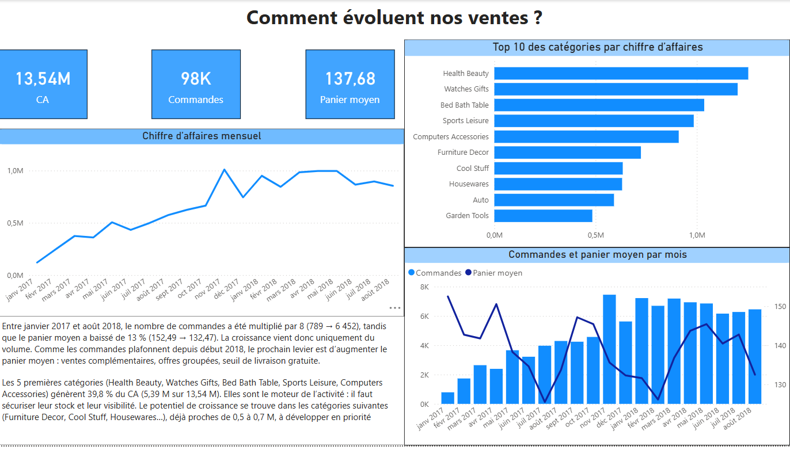
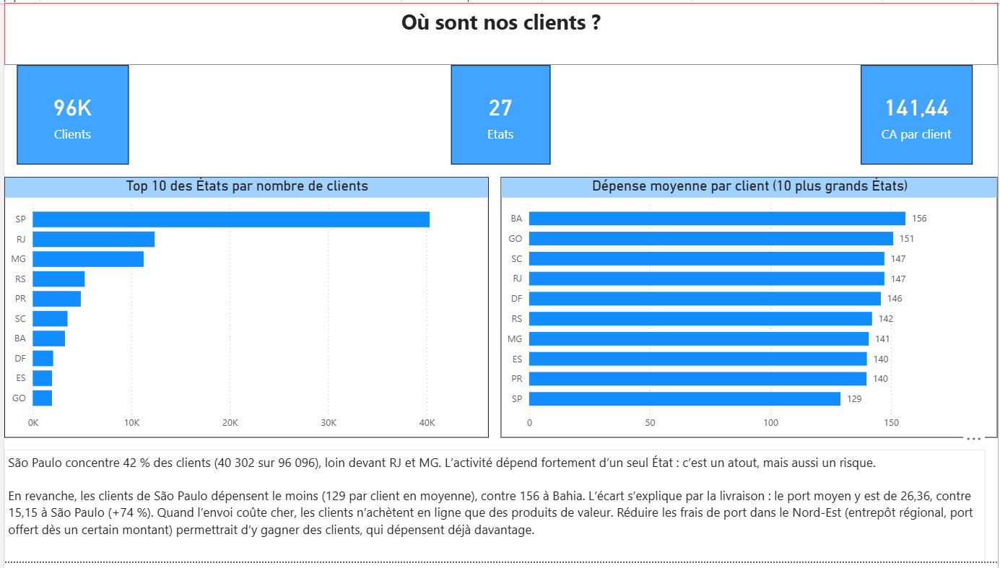
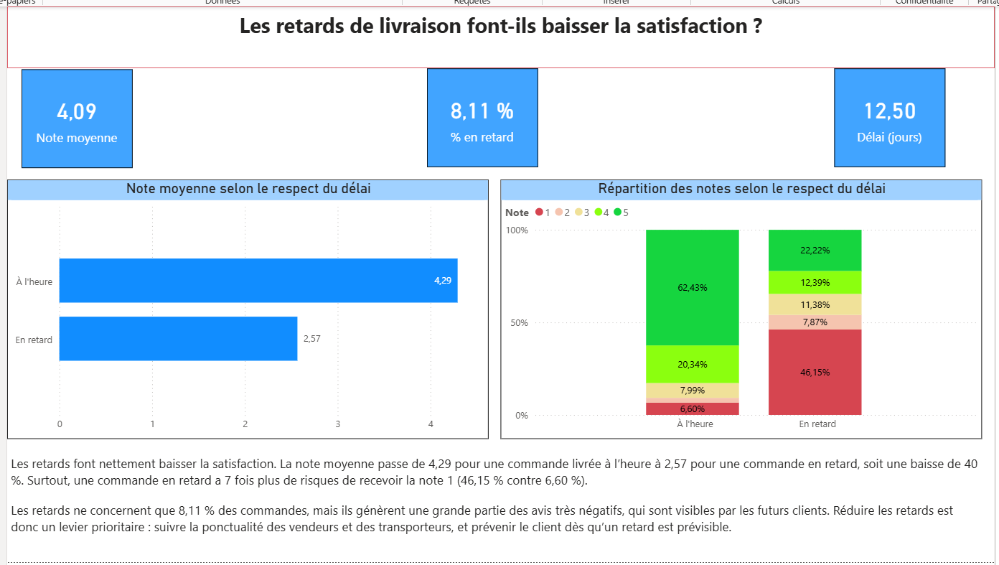

# Analyse commerciale d'un site e-commerce brésilien (Olist) – SQL

Projet d'analyse de données réalisé en **SQL (MySQL Workbench)** sur le dataset public **Olist** (Kaggle), une place de marché brésilienne en ligne.

L'objectif : répondre à **5 questions d'un manager** sur les ventes, les clients, la livraison, la satisfaction et les produits, puis formuler des **recommandations concrètes**.

---

## Données

- **Source :** [Brazilian E-Commerce Public Dataset by Olist](https://www.kaggle.com/datasets/olistbr/brazilian-ecommerce) (Kaggle)
- **8 tables utilisées :** `orders`, `order_items`, `order_payments`, `order_reviews`, `customers`, `products`, `sellers`, `category_translation`
- La table `geolocation` (1 million de lignes) n'a pas été utilisée.

**Contrôle de l'import :** 99 441 commandes, 112 650 articles et 103 886 paiements, soit les volumes attendus du dataset.

## Périmètre d'analyse

Pour que tous les résultats soient comparables, les mêmes règles s'appliquent à toutes les questions :

- **Commandes livrées uniquement** (`order_status = 'delivered'`)
- **Période : janvier 2017 – août 2018.** 2016 est exclue (démarrage de l'activité, 312 commandes). Les commandes après août 2018 sont des cas isolés.
- **Chiffre d'affaires (CA) = prix des articles**, hors frais de port, en réais brésiliens (R$).

---

## Questions et résultats

### Q1 – Comment évolue le chiffre d'affaires ?

**Sur un an (janvier–août 2017 contre janvier–août 2018) :** le CA passe de **2,99 M R$ à 7,22 M R$, soit +141 %**. Le nombre de commandes suit la même hausse (21 998 → 52 783), tandis que le **panier moyen reste stable** (environ 136 R$). La croissance vient donc du **volume**, pas du prix.

**Mois par mois :**
- **2017 : forte croissance.** Le CA est multiplié par 9 entre janvier et novembre.
- **Novembre 2017 : pic exceptionnel** (+52 % en un mois), probablement lié au Black Friday.
- **2018 : plateau.** Le CA oscille entre 826 000 et 978 000 R$ par mois, avec des variations de -12 % à +15 %. Le +141 % vient de la montée de 2017, pas d'une croissance en 2018.

> **Action :** chercher la cause du plateau (clients, panier, catégories) et préparer le Black Friday 2018.

### Q2 – Où sont nos clients ?

- **3 États génèrent 63,5 % du CA :** São Paulo (38,4 %), Rio de Janeiro (13,3 %) et Minas Gerais (11,8 %), dans le Sud-Est, la région la plus peuplée et la plus riche du Brésil.
- **13 États pèsent chacun moins de 1 %** (environ 6 % au total), surtout au Nord et au Nord-Est.
- **Fidélité très faible :** environ **1,03 commande par client**. Les clients achètent une fois et reviennent rarement.

> **Action :** fidéliser les clients du Sud-Est (programme de fidélité, relances après un premier achat).

### Q3 – Combien de temps nos clients attendent-ils ?

- Délai réel moyen : **12,5 jours**, pour un délai promis moyen de **24,3 jours**. Grâce à cette marge, seules **8,1 %** des commandes arrivent en retard.
- **São Paulo est l'État le plus rapide (8,7 jours)**, alors que Roraima attend près de **30 jours**.
- **Cause :** **60 % des 3 095 vendeurs sont à São Paulo**, et presque aucun dans le Nord. Les colis destinés aux États éloignés traversent tout le pays.
- **Point d'attention :** Rio de Janeiro, 2ᵉ marché, cumule 15,2 jours de délai et **13,5 % de retard**.

> **Action :** analyser les retards vers Rio, et recruter des vendeurs ou ouvrir des points de stockage dans le Nord et le Nord-Est.

### Q4 – Les retards font-ils baisser la satisfaction ?

| Statut | Commandes | Note moyenne |
|---|---|---|
| À l'heure | 88 390 (92 %) | **4,29 / 5** |
| En retard | 7 697 (8 %) | **2,57 / 5** |

Un retard fait perdre **1,7 point** de satisfaction. Avec une fidélité déjà faible (Q2), chaque retard risque de faire perdre un client.

> **Action :** réduire les retards en priorité à Rio et dans le Nord-Est, et contacter les clients livrés en retard (excuses, bon de réduction).

### Q5 – Quelles catégories rapportent le plus ?

- Les **10 premières catégories font 63,3 % du CA**. La première, health_beauty, pèse 9,5 % : aucune ne domine.
- **Deux modèles de CA :** bed_bath_table mise sur le **volume** (9 267 commandes, panier de 110 R$), watches_gifts sur le **prix** (5 491 commandes, panier de 212 R$).

> **Action :** des promotions sur les catégories d'achat régulier pour faire revenir les clients, et les catégories cadeaux mises en avant pour le Black Friday et les fêtes.

---

## Synthèse

Olist a connu une forte croissance en 2017, mais son CA **stagne depuis début 2018**. Les données suggèrent un enchaînement : des **délais longs** hors de São Paulo, des **retards qui font chuter la satisfaction**, et des clients qui **ne reviennent presque jamais**. La priorité est donc la **fidélisation** et la **logistique**, plus que l'acquisition de nouveaux clients.

## Techniques SQL utilisées

- Jointures sur plusieurs tables (`JOIN ... USING`), jusqu'à 4 tables
- Agrégations (`COUNT(DISTINCT)`, `SUM`, `AVG`, `MIN`, `MAX`) avec `GROUP BY`
- CTE (`WITH`)
- Fonctions de fenêtre : `LAG()` pour les croissances, `SUM() OVER ()` pour les parts en %
- `CASE WHEN` pour classer les commandes (en retard / à l'heure)
- Fonctions de dates : `YEAR`, `MONTH`, `DATEDIFF`

## Limites

- Le CA ne comprend pas les frais de port.
- Les produits sans catégorie ou sans traduction sont exclus de la Q5.
- Environ 100 commandes livrées n'ont pas d'avis client et sont absentes de la Q4.
- Les causes proposées (Black Friday, trafic à Rio…) sont des **hypothèses** à confirmer avec des données complémentaires.

## Fichiers

- `02_evolution_ca.sql` : Q1 – évolution annuelle et mensuelle du CA
- `clients_olist.sql` : Q2 – CA et clients par État
- `retards et baisse de ca.sql` : Q3 et Q4 – délais de livraison et satisfaction
- `produits qui se vendent le mieux.sql` : Q5 – catégories de produits
- `README.md` : ce document

## Tableau de bord Power BI

Après l'analyse SQL, j'ai construit un tableau de bord Power BI sur les mêmes données, avec un modèle en étoile (commandes, lignes de commande, produits, catégories, clients, avis).

 📄 [Voir le tableau de bord complet (PDF)](dashboard_olist.pdf)

### Page 1 : Comment évoluent nos ventes ?

- Les commandes ont été multipliées par 8 entre janvier 2017 et août 2018, mais le panier moyen a baissé de 13 % : la croissance vient uniquement du volume.
- Les 5 premières catégories génèrent 39,8 % du chiffre d'affaires.

### Page 2 : Où sont nos clients ?

- São Paulo concentre 42 % des clients, mais ce sont ceux qui dépensent le moins (129 contre 156 à Bahia).
- Hypothèse vérifiée dans les données : le port moyen est 74 % plus cher à Bahia. Quand la livraison coûte cher, les clients réservent leurs achats en ligne aux produits de valeur.

### Page 3 : Les retards de livraison font-ils baisser la satisfaction ?

- Une commande en retard reçoit une note moyenne de 2,57, contre 4,29 à l'heure (-40 %).
- Une commande en retard a 7 fois plus de risques de recevoir la note 1 (46,15 % contre 6,60 %).

### Compétences mobilisées

Power Query (types de données, nettoyage), modélisation en étoile, DAX (mesures, colonnes calculées, CALCULATE, DIVIDE, DATEDIFF, DISTINCTCOUNT), filtres Top N, choix des visuels, rédaction de conclusions orientées décision.

---

**Auteur :** Christian Nguemewe – Junior Data Analyst
[LinkedIn](https://www.linkedin.com/in/christian-nguemewe)
